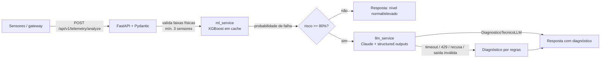

# Pipeline de Telemetria Industrial para Manutenção Preditiva

Diagnóstico automatizado de falhas em turbinas e caldeiras: um modelo XGBoost estima a probabilidade de falha a partir da telemetria e, quando o risco passa de 80%, o Claude gera um diagnóstico técnico estruturado.


## Fluxo de dados



## Instalação

```bash
python -m venv .venv && source .venv/bin/activate   # Windows: .venv\Scripts\activate
pip install -r requirements-dev.txt                   # só runtime: requirements.txt
cp .env.example .env                                  # preencha ANTHROPIC_API_KEY

python -m src.train                                   # gera models/predictive_model.joblib
uvicorn src.main:app --reload
```

Exemplo de chamada:

```bash
curl -X POST localhost:8000/api/v1/telemetry/analyze \
  -H "Content-Type: application/json" \
  -d '{"equipamento_id":"TURB-03","temperatura_mancal_celsius":118,"vibracao_rms_mm_s":12.5,
       "pressao_linha_bar":41,"rpm_rotor":3480,"horas_operacao_continua":950}'
```

Sensores podem ser omitidos (mínimo de 3 válidos); os ausentes voltam em `sensores_ausentes`. Campos desconhecidos são rejeitados com 422: um sensor com nome errado no gateway não vira "ausente" em silêncio.

### Docker

```bash
docker compose run --rm api python -m src.train   # treina e grava em ./models
docker compose up --build
```

No Linux, o container roda como usuário não-root (uid 10001) e pode não ter permissão de escrita em `./models`. Nesse caso, treine com o seu usuário: `docker compose run --rm --user "$(id -u):$(id -g)" api python -m src.train`.

### Testes

```bash
python -m pytest
```

A suíte treina um modelo pequeno em diretório temporário e substitui o cliente Anthropic por um mock: nenhuma chamada de rede, nenhuma chave necessária.

## Decisões de Arquitetura & Trade-offs

**Dados sintéticos.** O treino gera 2.500 amostras com ruído de sensor, sobreposição entre classes e 1,5% de leituras ausentes. Serve para validar o pipeline ponta a ponta; as métricas (F1 ≈ 0,98) refletem a facilidade do gerador, não o desempenho esperado em planta. Em produção o primeiro passo é trocar `gerar_telemetria_sintetica` por histórico real rotulado com ordens de manutenção.

**XGBoost em vez de rede neural.** Dados tabulares com cinco variáveis: árvores treinam em segundos, lidam com `NaN` nativamente (sensor ausente não exige imputação) e dispensam GPU. O custo é não capturar dependência temporal; janelas deslizantes (média/derivada de vibração) seriam a evolução natural.

**LLM só acima do limiar.** O modelo clássico é barato e determinístico; o Claude entra apenas nos casos críticos (`LIMIAR_ALERTA`, padrão 0,80). Reduz custo e latência para a maioria das requisições, ao preço de não haver explicação textual para riscos intermediários.

**Saída estruturada via structured outputs.** O schema Pydantic `DiagnosticoTecnicoLLM` vai em `output_config.format`, e a API restringe a geração a esse JSON. A resposta ainda é revalidada pelo Pydantic, porque limites como `minLength` e `maxItems` não são impostos pela API. Saída fora do contrato é tratada como falha do provedor, não como dado confiável. Tool use com `tool_choice` forçado não serve aqui: os modelos atuais rejeitam essa opção com HTTP 400.

**Fallback em duas camadas.** Se o modelo principal recusar a requisição por política, o fallback de servidor da Anthropic (`fallbacks: "default"`) refaz a chamada em outro modelo, dentro da mesma requisição. Se ainda assim não houver diagnóstico, por timeout, 429, erro de conexão, recusa, resposta truncada ou inválida, ou falta de chave, entra o diagnóstico heurístico (`fonte_diagnostico: "regras_fallback"`). Um alerta crítico nunca fica sem diagnóstico por causa de terceiros. O custo é um texto genérico, sinalizado de forma explícita na resposta.

**Cache do modelo com `lru_cache`.** O artefato carrega uma vez por processo. Como exceções não são memorizadas, um modelo que aparece depois (volume montado, retreino) é carregado na próxima requisição sem reiniciar; enquanto isso a API responde 503 com `Retry-After`. Trocar um modelo já carregado exige reiniciar o processo ou chamar `carregar_modelo.cache_clear()`.

**Modelo fora da imagem Docker.** O `.joblib` é montado por volume: a imagem fica enxuta (multi-stage, usuário não-root) e o modelo é versionado separadamente do código.

**Modelo de LLM configurável.** O identificador vem de `ANTHROPIC_MODEL`; trocar de modelo não exige deploy de código.
